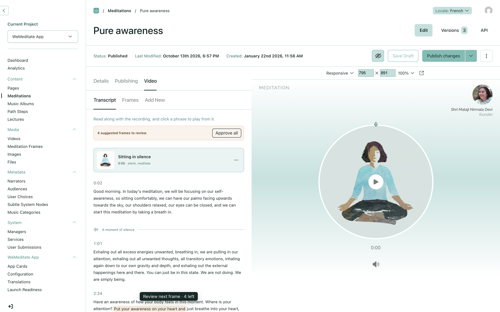
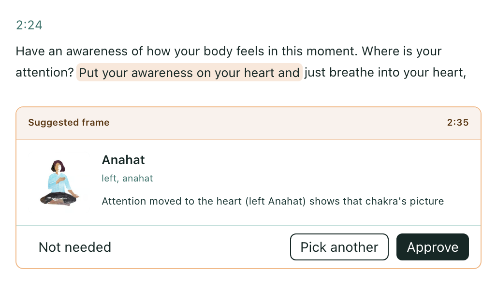
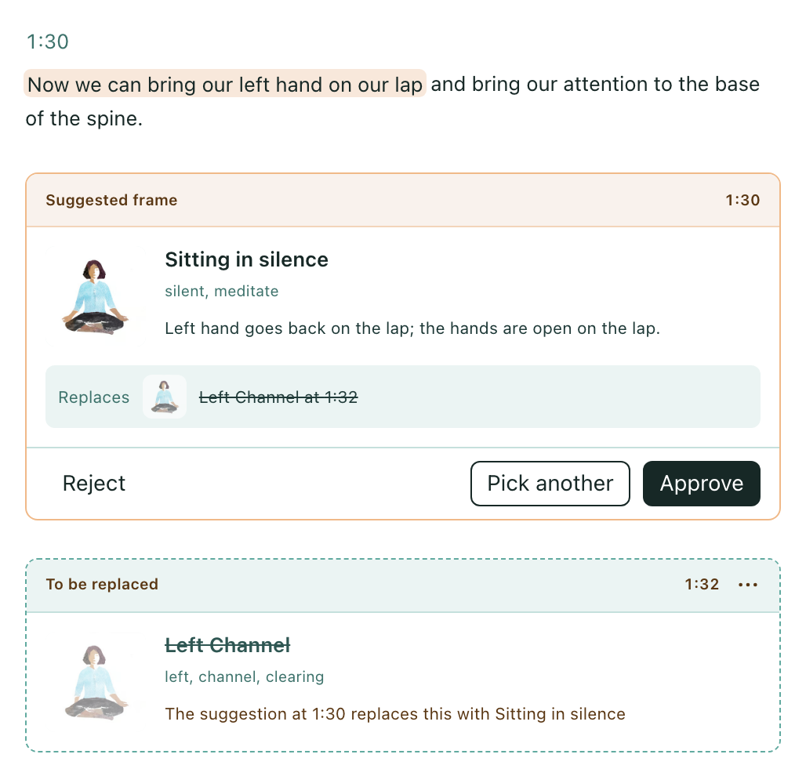
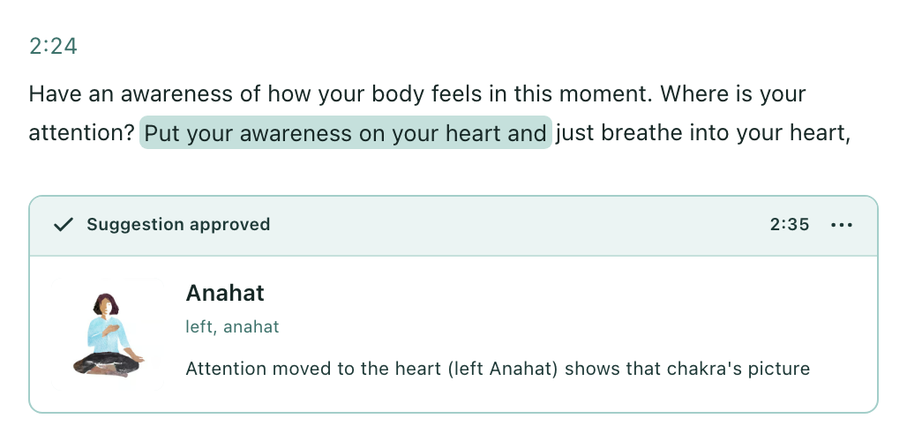
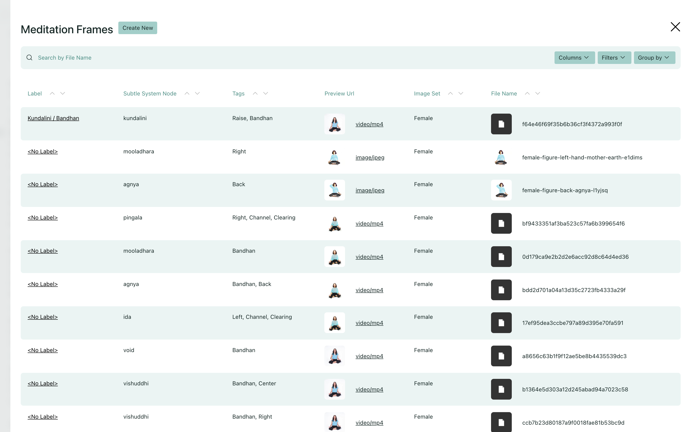
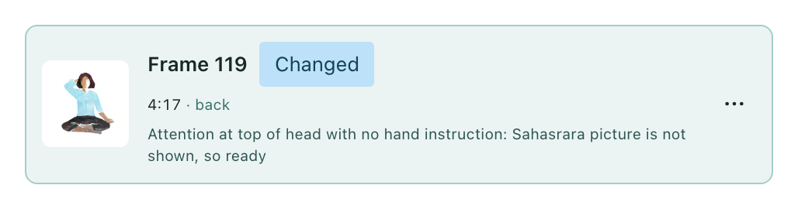
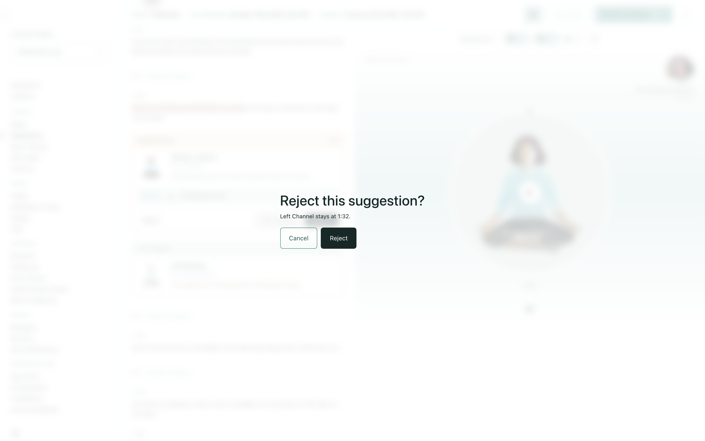
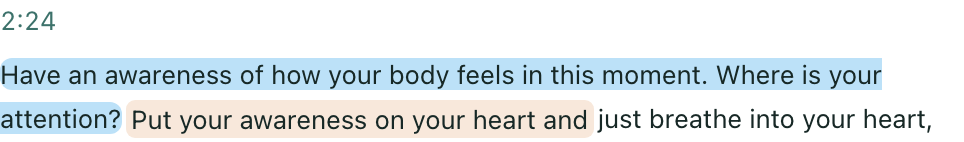

# Editors approve, change or reject suggested frames, right in the transcript

Placing frames today means listening to a whole recording and noting every moment the hands should move. This proposal brings two things: a way of suggesting every frame from the transcript that was tested against the editors' own work, and a screen in the #897 Transcript tab where an editor goes through the suggestions and decides on each.

**This is a proposal to react to, not something to merge.** It is on the branch [`proposal/898-frame-suggestions`](https://github.com/sydevs/SahajCloud/compare/proposal/897-transcripts...proposal/898-frame-suggestions). The branch is stacked on #897's [`proposal/897-transcripts`](https://github.com/sydevs/SahajCloud/compare/main...proposal/897-transcripts), because the screen builds on that tab, so the link compares against it rather than `main`.

## In short

- **One call to Claude Sonnet 5.5 per meditation**, with the whole transcript, suggests every frame: the moment, the picture and a reason. It costs about 2 cents and takes about 6 seconds.
- **On 14 meditations it had never seen, it showed the same picture as the editors 92% of the time.** Judged against the rules, it was wrong 3.3% of the time, and 2.0% without one transcription fault. The editors were wrong 1.8% of the time.
- **Jev was tried first and dropped.** Placing frames needs the context of the whole meditation, and Jev sees one piece at a time. At its best it was wrong 13% of the time by the same measure.
- **The rules are settled.** Anton decided them case by case on real meditations. They are written down with the example behind each one, in [`pipeline/rules.md`](pipeline/rules.md).
- **Editors stay in charge.** A suggestion changes nothing until an editor approves it and saves the meditation.

## Everything behind the screen still needs building

This is a UI proposal, and the suggestions were made locally. None of the machinery behind the screen exists yet:

- making a meditation's suggestions once its transcript is ready, the way [`pipeline/`](pipeline/README.md) describes (question 1 below asks whether this happens on its own or on an editor's click);
- keeping each meditation's suggestions: the time its instruction starts, the words it is based on, the frame, a one-sentence reason, whether the model was unsure, and, if there is one, the editor's frame it disagrees with;
- offering only frames from the image set that matches the narrator's gender;
- not showing a suggestion the editors have already made;
- keeping a rejected suggestion rejected, after a reload and after the suggestions are made again;
- making the suggestions again, or marking them out of date, when the recording, the transcript, the rules or the picture descriptions change, without ever touching frames an editor has approved;
- recording what editors decide on each suggestion (question 3);
- the on/off switch from this goal's decisions, and a plain message when the service is unavailable.

Approving needs no new storage: it edits the meditation's frames like any other edit. How each of these is done is left to the implementation.

## How the suggestions are made

Full detail, the exact prompt, and everything needed to rebuild and re-test it are in [`pipeline/README.md`](pipeline/README.md). In brief:

1. **The input** is the #897 transcript, which has a start time for every word. It is cut into numbered sentences, each with its start time, such as `[s5 0:36] We can place our hand at the bottom of our spine…`.
2. **One call to Claude Sonnet 5.5** gets that transcript and three fixed parts, which are cached and so cost a tenth after the first call:
   - the rules, written as instructions ([`prompt-rules.txt`](pipeline/prompt-rules.txt));
   - what each chakra and channel is responsible for, from wemeditate.com, for narrators who name a quality rather than a place ([`prompt-subtle-system.md`](pipeline/prompt-subtle-system.md));
   - every picture in the narrator's image set, one line each: still or video, what it shows, and what it is *not* for ([`prompt-catalogue-female.txt`](pipeline/prompt-catalogue-female.txt)).
3. **The answer** is a list of frame changes in a fixed JSON format. Each one gives the sentence, the first words of the instruction, the picture's name, whether it is a position, a movement, a return to the lap or unsure, and a reason.
4. **Plain code turns that into frames.** It finds the quoted words in the transcript and starts the frame on that word, so **the model never writes a time**. Models are unreliable with numbers like 4:37, but they quote words reliably, and the starts were exact in all but 4 of about 4,600 frames. The code also maps each name to a frame id in the narrator's set, shows the hands-on-the-lap "ready" picture whenever the model is unsure, and returns to ready in the silence after the last word.

## How it was tested

- **Fixed test sets, chosen before any tuning.** Two sets of 8 and 14 meditations were used for tuning, and their errors were read. A third set of 14 was sealed: it was scored only once, at the end, so it shows how the suggester does on meditations nobody tuned it on. Every meditation ran three times and the scores are means, because the models don't answer the same way twice.
- **Scored second by second against the editors' frames on production:** how much of each recording shows the same picture, a picture of the wrong place on the body, any wrong picture, or the lap where an instruction was missed. Changes were scored too: does the suggestion change the picture where the editors did?
- **Judged by the rules, because agreement isn't accuracy.** Two editors who placed frames on the same recording (#9 and #92) agree only 74% of the time, and editors are sometimes wrong. So a separate model read every stretch of 5 seconds or more where the suggester and the editors disagree, with the transcript and both pictures, and decided by the rules who was right. This measure decided between the approaches.

| Approach | Tested on | Same picture as the editors | Wrong place on the body | Wrong by the rules |
| --- | --- | --- | --- | --- |
| Jev, one request per piece of transcript | tuning set | 59% | 11% | – |
| Jev, one request per sentence, plus rules in code | tuning sets | 75–79% | 2–3% | 10.9% |
| Jev, one request per sentence, plus rules in code | sealed set | 85% | 4% | 12.9% |
| Claude Haiku 5.5, whole meditation | tuning sets | 83–84% | 2–3% | 8.1% |
| Claude Sonnet 5.5, whole meditation | tuning sets | 86–87% | 4% | 2.9% |
| Claude Sonnet 5.5, with Anton's rules | sealed set | 88% | 2% | **4.9%** |
| **Claude Sonnet 5.5, final rules** | sealed set | **92%** | **2%** | **3.3%** |
| *The editors, judged the same way* | *tuning sets / sealed set* | | | *2.5% / 1.8%* |

On the sealed set, the first judging found that 396 of Sonnet's 642 wrong seconds came from two rules it had not been given yet. One is that attention moving to the top of the head ends the picture on screen. The other is that the silence after the last word goes back to the lap. With both added, those errors are gone. The remaining 432 seconds have nothing to do with the rules. Most of them are fixable in the picture descriptions or in code: a transcription loop in #129 that hid an instruction (165 s), the left-hand ground picture chosen for "put our right hand on the ground" because its pose name misleads (140 s), "place our hands on the ground" shown with one hand (94 s), and a closing return to the lap placed 20 seconds before the last word (18 s). The editors' rate fell from 2.5% to 1.8% partly because several of their frames on these meditations were corrected on production the same day.

## Why not Jev

Jev, TypeSafe's classification model, was the first idea: send it a piece of transcript and let it pick the picture. It picks one option from a list and reports how sure it is, which fitted that idea well. It was pushed a long way, and it stopped at a ceiling for reasons that belong to the task, not to tuning:

1. **Placing frames needs the whole meditation in mind.** Which hand is still on the ground, whether a prayer belongs to the movement before it, when a movement ends, whether "in this meditation we will raise the Kundalini" is an instruction or an announcement. Jev sees one piece at a time, and the judge traced most of its remaining errors to exactly these cases.
2. **Jev doesn't answer the same way twice.** Identical requests came back up to 0.13 apart in probability. In the first design, each request said which picture was already on screen, which came from Jev's own last answer, so one noisy answer changed every later one: two identical runs of one meditation scored 69% and 49%.
3. **Fixing that meant layers of rules in code**, which is what we wanted to avoid: decide the place first, a probability margin, keep-the-pose rules, merged options, a "not for" line on every picture. They took agreement from 59% to 79%, but it stayed wrong 11–14% of the time by the rules, against the editors' 2.5%.
4. **One Sonnet call with the whole transcript fixed all of those at once**, with no new rules. Missed instructions fell from 8–13% to 2–3%, and the judged error to 2.9%. It was also cheaper: Jev needed about 75 requests per meditation (2.2 cents), Sonnet one cached call (1.7 cents). The rules in code were all deleted.
5. **What Jev did better** was report how sure it is. Sonnet's own "unsure" isn't reliable in the same way. Showing the lap whenever it is unsure, and flagging those frames for an editor, covers this.

Claude Haiku 5.5 costs a twentieth as much, but it picked wrong videos and misread rules: 8.1% wrong, mostly in the error a listener notices first. Cloudflare's Clef costs about five times as much as Jev and would have had the same one-piece-at-a-time problem.

## How the rules were settled, and why they shouldn't change without a re-test

The rules came out of the errors, one at a time:

1. **The editors' habits came first.** Which phrase gets which picture was mined from the frames editors had placed across the library.
2. **Every disagreement was read.** Where the suggester and the editors differed, both were checked against the words. Sometimes the editors were wrong, sometimes the rules were missing, and sometimes a picture's description was. Two picture descriptions turned out to be wrong: frames 53 and 120 show the *left* hand to the ground, and male frames 78 and 80 show a woman.
3. **Anton decided each open case on a real example.** He saw the whole transcript and the picture each choice would show, never a rule in the abstract. Questions such as "does a video keep looping through the prayer after the movement?", "does moving the attention to a chakra get its picture?" and "which picture when nothing fits?" were each settled this way, with the meditation that settled them.
4. **Production was corrected along the way.** On 13 October the frames, narrator genders and timings of 62 meditations were fixed, and on 14 October 12 more after Anton's rulings, each one read back after the write.
5. **Each new rule went into the prompt, and all three test sets were re-run**, so that a fix in one place could not break another.

So each rule in [`pipeline/rules.md`](pipeline/rules.md) carries the example that decided it. A rule that looks arbitrary, such as "the heart alone means the left Anahat", "an attention tour gets one picture per chakra" or "a frame 3.1 seconds late can stay", was a deliberate choice on a real case. The same holds for the approach: whole transcript, quoted words instead of times, the lap when unsure, and Sonnet over Haiku. Each alternative was measured and was worse. [`pipeline/README.md`](pipeline/README.md) lists these under "Things to keep as they are". Changing any of them should go through the same tests.

## What the branch contains

On top of #897's branch:

1. **[Claude's frame suggestions for meditations 4, 45, 69 and 83](https://github.com/sydevs/SahajCloud/commit/bae1824e)**: `seeds/frame-suggestions/<id>.json`, the demo data.
2. **The screen**, in iterations from [`08f106bd`](https://github.com/sydevs/SahajCloud/commit/08f106bd) to [`75ba2dd9`](https://github.com/sydevs/SahajCloud/commit/75ba2dd9): frames set into the transcript, the card for every state, Approve all, the words behind each suggestion, the review button, the Reject confirmation, and the playing phrase in blue. Each commit message explains its change.
3. **[One sheet of every state](https://github.com/sydevs/SahajCloud/commit/f5010a8d)**, plus the screenshots below.
4. **[How the suggestions are made](https://github.com/sydevs/SahajCloud/commit/8c8e825f)**: the rules, the exact prompt, the picture catalogue and the test results, in `docs/proposals/898-frame-suggestions/pipeline/`.
5. This text.

Two earlier commits ([`242889b0`](https://github.com/sydevs/SahajCloud/commit/242889b0), [`d494ca4d`](https://github.com/sydevs/SahajCloud/commit/d494ca4d)) hold a first version that used Jev and a separate review panel. The commits after them replace it.

## What the screen does

It lives in a meditation's **Video → Transcript** tab, beside the live preview.

- **Frames sit in the transcript where the picture changes.** A card breaks the text after the phrase playing at the frame's time, so editors read the narration and the pictures together. The player doesn't change: the live preview already shows unsaved frames.
- **Every card has the same layout.** A header says what it is, with the time (click it to play from there), and a "…" menu with Change and Remove on frames. Below are the picture, its name, its tags and the reason. The states:

  | State | Header | Look |
  | --- | --- | --- |
  | A suggestion | Suggested frame | orange header and border, with Reject · Pick another · **Approve** at the bottom |
  | A suggestion that replaces an editor's frame | Suggested frame | as above, plus "Replaces Left Channel at 1:32" |
  | The editor's frame it would replace | To be replaced | dashed border, faded picture, name struck through, and a note naming the suggestion |
  | Approved | ✓ Suggestion approved | neutral |
  | Another frame picked instead | ✓ Changed from the suggestion | neutral, with "Suggested: …" in place of the reason |
  | The editor's own frame | Frame | neutral |

- **The words behind each suggestion are highlighted**: orange while it waits, the theme's soft teal once its frame is in. A highlight stops at its card. A rejected suggestion leaves none.
- **The phrase playing is now blue.** This changes #897's design, where it was orange, so that it never looks like a suggestion's words.
- **A strip at the top** reads "4 suggested frames to review", with **Approve all**. It disappears when nothing is waiting.
- **"Review next frame · 3 left"** floats at the bottom while no waiting suggestion is on screen, and scrolls to the next one.
- **Reject asks first**, in Payload's confirmation dialog: "No frame will be added at 2:35", or "Left Channel stays at 1:32".
- **Pick another** opens Payload's list drawer with only the frames for the narrator's gender. The chosen frame goes in at the suggestion's time.
- **Every edit is an unsaved change to the meditation's frames**, like the existing Add New inserter. Save Draft keeps it, and a toast says so.
- **Approved and changed are not stored anywhere.** They are worked out from the frames: a suggestion counts as handled once the meditation has a frame at that second, so reloading or saving keeps them.

## Screenshots

All from meditations #4 and #69 on a copy of production, at 1600 px with the live preview open.

**1. The Transcript tab with suggestions waiting**
A strip at the top says how many suggestions are waiting, with **Approve all**. The editor's own frames sit in the text where they start. While no suggestion is on screen, **Review next frame** floats at the bottom.

**2. A suggestion that adds a frame**
The card sits right after the words that prompted it, and those words are highlighted. It shows the frame, its tags and why it was picked.

**3. A suggestion that would replace an editor's frame**
The card says what it replaces. That frame, just below, is struck through as "To be replaced" until someone decides. Approving swaps one for the other. (This particular suggestion is wrong, and the final rules no longer make it. See "Data" below.)

**4. Approved**
The card turns neutral. Its words stay highlighted in a quieter colour, so it is still clear where each picture came from.

**5. Another frame picked instead**
**Pick another** opens Payload's own list of frames, only those for the narrator's gender. The card then notes what had been suggested.

**6. Reject asks first**
The confirmation says what stays: no frame at that time, or the editor's frame the suggestion would have replaced.

**7. While the recording plays**
The phrase playing is blue and the words behind a suggestion are orange, so the two never look alike.

**Every state on one sheet:** [all-states.png](all-states.png)

## How it was made, and what it assumes

- **Components.** Payload's `Button`, `Banner`, `Popup` with `PopupList` (the "…" menu), `ConfirmationModal` (Reject), `useListDrawer` (Pick another), `useModal`, `toast` and `useField`, and lucide icons, which the project already uses. The one custom component is `FrameCard`, because Payload has nothing for a card set into running text. Everything else is layout CSS with Payload's theme variables.
- **Where the code is.** `src/components/admin/MeditationTranscript/`: `FrameCard.tsx`, `TranscriptView.tsx`, the pure logic in `frames.ts` and `rows.ts`, and `useFrameSuggestions.ts`, which edits the `frames` field. 48 unit tests are in `tests/unit/transcript-{frames,rows,frame-card}.spec.ts`.
- **What is faked.** The tab reads `seeds/frame-suggestions/<id>.json` from disk, which stands in for wherever suggestions end up being kept. Nothing makes, stores or refreshes suggestions, and there is no collection, endpoint, job or migration. Like #897's tab, it runs locally only.
- **Data.** Real suggestions from Sonnet for meditations 4, 45, 69 and 83, with suggestions the editors had already made left out. They come from an earlier version of the rules, so the cards show what the screen does, not what the final suggester would say. The suggestion at 1:32 in screenshot 3 is one of the errors the final rules fixed: after "bring the left hand to the lap", the right hand stays on the ground, so the editor's frame was right.
- **Limits.** A suggestion's time is changed after approving it, in the existing Frames tab, not on the card. Approve all has no undo except not saving the draft. Some frames have no label in the CMS, so their card reads "Frame 119". That is a gap in the frames data, not in this screen.
- **Not shown.** Suggestions the model was unsure about, and stretches where the transcript may hide an instruction (a run of one repeated word), should be marked for the editor. The demo data has neither, so the screen doesn't mark them yet. The feature switched off, and the service unavailable, need the real machinery.

## Answers to the goal's open questions

- **1C**: done already. Every picture in the library now has a description of its pose, for both image sets, including what each one is *not* for ([`pipeline/prompt-catalogue-*.txt`](pipeline/)). With them, suggestions name both the moment and the picture, and the picture matched the editors' 92% of the time on meditations the suggester had never seen.
- **2A**: done, with Anton as the named person. He set the rules on real examples rather than by impression, and the bar was measured on a sealed set: at most 3% wrong place, at most 8% wrong picture shown, at least 75% the same picture, and the judged error close to the editors'. The result is good enough to give editors suggestions they approve, not to place frames on its own.
- **3B**: a rejected suggestion stays rejected. The suggestions have to be kept anyway, because they are made once per transcript, so a rejection is one more field. Without it, every re-run brings back everything an editor has already turned down.
- **4A**: one Anthropic API account for every AI feature, with a key for previews too. Suggesting frames for the whole library costs about $2.50 (126 meditations at 2 cents each). The pilot used Anton's own key, so there is no key in Railway yet.
- **5A**: English first. Only English was tested, and 121 of the 122 published meditations are English.

## Decisions this touches

- **Confirms** "Does a suggestion ever get saved onto the meditation before an editor accepts it? → No" (#881, 2026-10-02). Approving is an unsaved change, and nothing reaches the website or the app until the editor saves and publishes.
- **Changes**, if question 1 is answered A: "What starts a suggestion run? → An editor asks for it, and the service has an on/off switch. Nothing runs on its own" (#881, 2026-10-02). Suggestions would be made as soon as the transcript is ready. The on/off switch stays.
- **Changes** three lines of "Not included":
  - "Describing each library picture's pose in words" is done.
  - "Re-doing the pictures on the 73 meditations that already have them" is touched by question 2: the screen shows suggestions that replace an editor's frame.
  - "Learning from which suggestions editors keep" is touched by question 3, as a record that a person reads, not automatic learning.
- **Changes #897's design** in one place: the phrase playing is blue instead of orange.

## Open questions

- [ ] **1. When are a meditation's suggestions made?**
  - **A — Automatically, as soon as its transcript is ready (recommended):** editors find them waiting when they open the tab. At 2 cents a meditation, the cost is negligible. This changes the decision that an editor always asks. The on/off switch stays.
  - **B — When an editor asks:** keeps the decision as it is, at the cost of a button and a wait of about 6 seconds each time.
- [ ] **2. Should meditations that already have frames get suggestions too?**
  - **A — Yes, as suggestions that replace the editor's frame (recommended):** judged by the rules, editors' frames are wrong about 2% of the time, and the pilot found and fixed 12 meditations on production this way. Where the suggester agrees with the editors, nothing is shown.
  - **B — No, only meditations without frames:** less to review, and existing mistakes stay until someone notices them.
- [ ] **3. Should editors' decisions on suggestions be recorded?**
  - **A — Yes (recommended):** every Approve, Reject and Pick another is a check of the suggester, so together they become a running accuracy measure at no extra cost, and a list of cases that may need a new rule. A person reads it, and a new rule still goes through the tests.
  - **B — No:** nothing extra is stored, and the only accuracy figures are the pilot's.
- [ ] **4. Do editors see the reason under each suggestion?**
  - **A — Yes, written for them (recommended):** the prompt asks for one plain sentence aimed at an editor. Today's reasons are the model's own notes and sometimes read badly, for example "Sahasrara picture is not shown, so ready".
  - **B — No:** the card shows only the picture and the words that prompted it.

## What I'm asking

Please fold the screen's behaviour, the requirements above and the answers to questions 1–5 into the goal. Treat [`pipeline/`](pipeline/README.md) as the specification for how the suggestions are made, and the screen as a reference for the implementation, not code to merge. Then please answer the four new questions.
