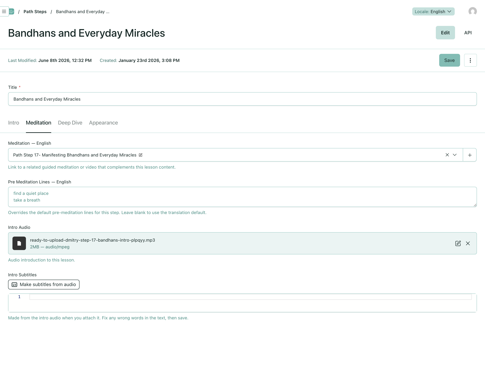
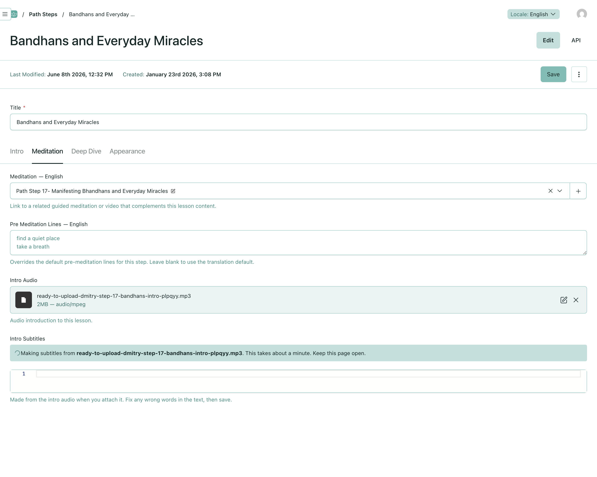
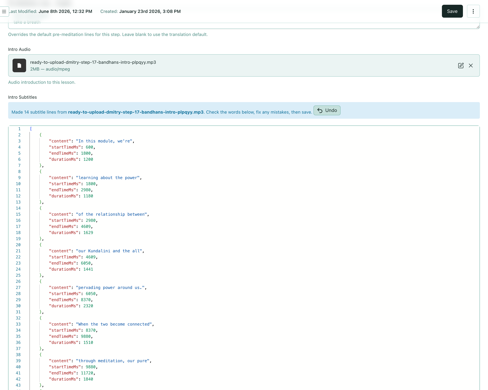
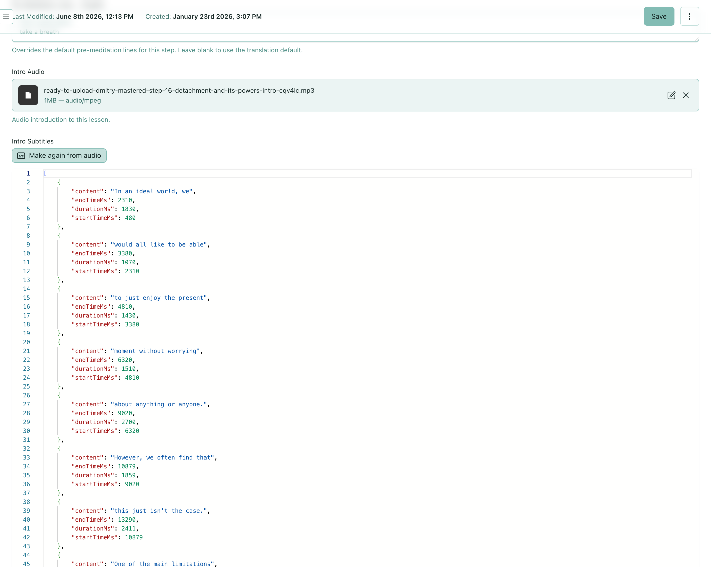
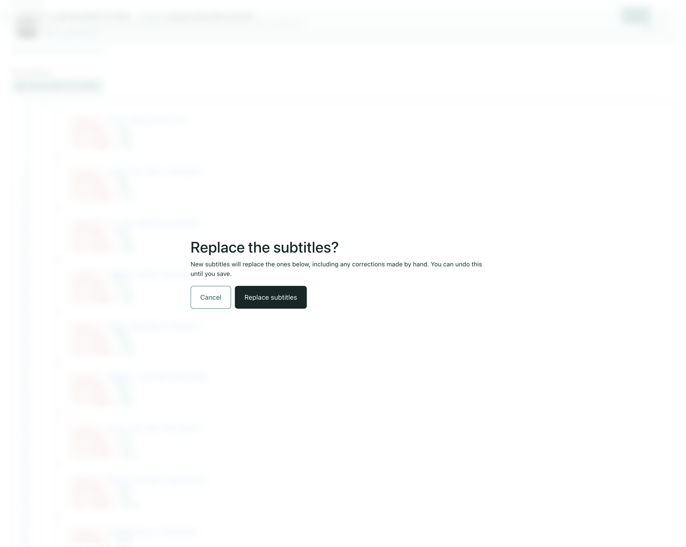
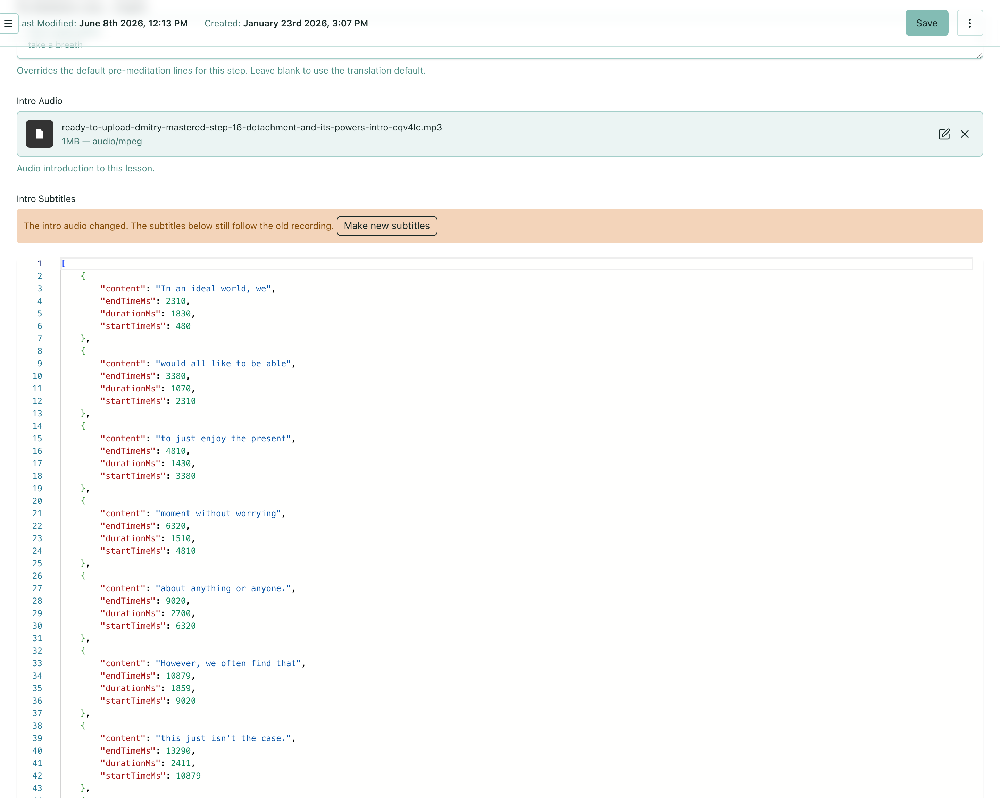
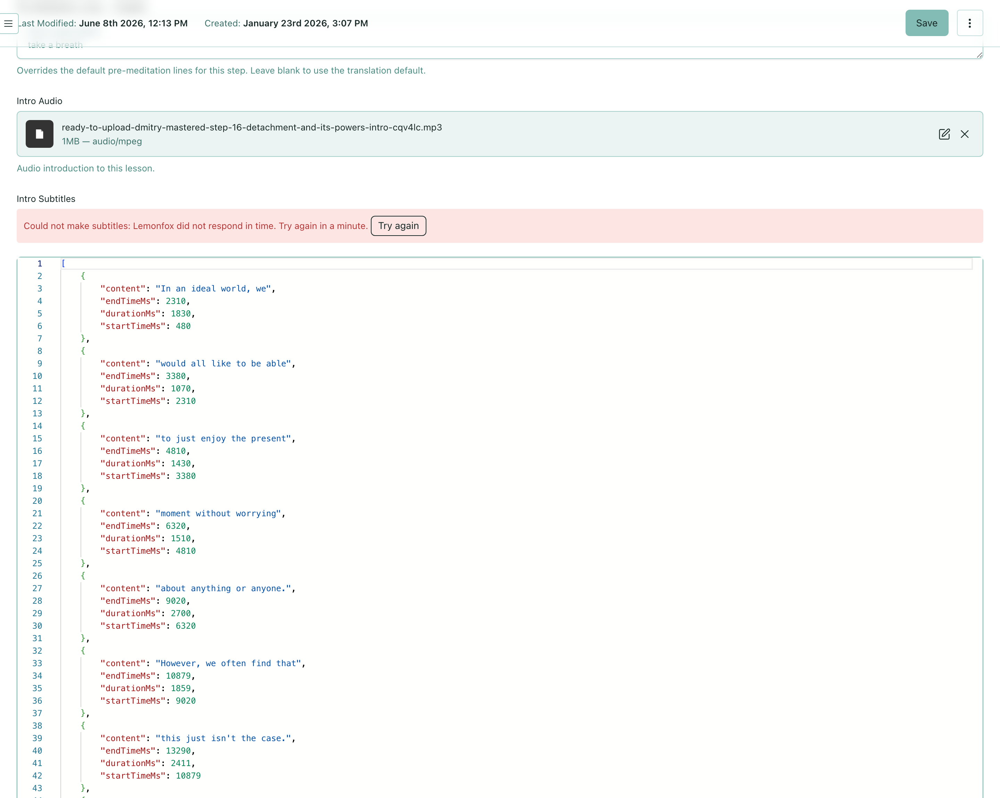

# Path admins get intro subtitles made from the intro audio

Today a Path Step's intro subtitles must be typed by hand, as JSON with a start and end time in
milliseconds for every line, so every intro so far was made by a developer outside the CMS. This
prototype shows what a Path admin would see instead: they add the intro recording, the subtitles
appear in the field, and they read them through, fix any wrong words and save.

**This is a proposal to react to, not something to merge.** It is on the branch
[`proposal/941-intro-subtitles`](https://github.com/sydevs/SahajCloud/compare/main...proposal/941-intro-subtitles).
It replaces the earlier branch `proposal/intro-subtitles-transcription`, which the goal's Notes
still link.

## Everything behind the screen still needs building

This is a UI proposal only. None of the machinery behind it exists yet:

- turning the recording into timed text, in English, the language of every intro today;
- splitting that text into short lines of about 30 characters at most, like steps 1–18, with
  each line's timing following the recording;
- doing this for a recording that has just been attached and is not saved yet, and returning
  within about a minute;
- allowing it only for people who can edit Path Steps;
- reporting a failure to the page, with a reason a person can act on.

How each of these is done is left to the implementation.

## What the branch contains

1. **[The control above the Intro Subtitles field](https://github.com/sydevs/SahajCloud/commit/775dcb52)**:
   one small component, wired onto the existing field, with the transcription faked.
2. **These screenshots and this text.**

## What it does

Everything happens above the existing Intro Subtitles editor, on the Path Step's **Meditation**
tab. The editor itself is unchanged, and it stays the place to fix a wrong word.

- **A step with audio and no subtitles.** A **Make subtitles from audio** button. Opening a page
  never starts a transcription by itself.
- **Adding a recording to a step with no subtitles.** Making them starts at once, with no other
  click. A banner names the recording and says to keep the page open.
- **Done.** The lines appear in the editor, unsaved. A banner says how many lines were made from
  which recording, and offers **Undo**, which puts back what was there before. Nothing is saved
  until the admin presses Save.
- **A step that already has subtitles.** A quieter **Make again from audio** button. It asks
  before replacing, because the old lines may hold hand corrections.
- **The recording swapped on the page.** A warning says the subtitles still follow the old
  recording, with **Make new subtitles** (which also asks first).
- **Failed.** The reason, and **Try again**. The old subtitles stay as they were.
- **Anyone who can't edit Path Steps, or a step with no recording.** Nothing extra appears.

These map one to one onto the goal's success lines.

## Screenshots

**1. Step 17 has its intro recording but no subtitles: one button**

**2. Making them. This starts by itself when a recording is added to a step with no subtitles**

**3. Done: 14 lines in the editor, not saved yet, with Undo**

**4. Step 16 already has subtitles: a quieter "Make again from audio"**

**5. Replacing existing subtitles always asks first**

**6. The recording was swapped on the page: the subtitles still follow the old one**

**7. Making them failed: the reason, Try again, and the old subtitles kept**

## How it was made, and what it assumes

- **Components.** Payload's own `Banner`, `Button`, `Spinner` and `ConfirmationModal`, plus two
  lucide icons. One custom component, `SubtitlesFromAudio`, because Payload has no control that
  fills one field from another. It sits above the existing JSON editor as the field's
  `beforeInput`, so it adds no collection, no field and no database column. The field's
  description is reworded in plain language.
- **What is faked.** `src/components/admin/SubtitlesFromAudio/mockTranscribe.ts` waits 3.5 s and
  returns the first 14 lines of step 17's real intro subtitles, in the shape the real request
  must return. `?mockState=making`, `made`, `failed` or `audio-changed` on the page's URL opens
  each state.
- **Data.** A local copy of production. Step 17's subtitles were cleared in that copy, to show a
  step with audio and none. No data is committed.
- **Limits.** The "recording changed" warning compares with the last saved recording, so it
  shows only while the admin is still on the page, as the goal's Not included list says.
  Leaving the page while subtitles are being made loses the result, which is why the banner says
  to keep it open. Undo lasts until the next save.

## Decisions this touches

None. The goal has no Decisions yet. The prototype stays inside its Not included list: no
automatic spelling fixes, no memory of which recording the subtitles came from, intro audio
only, and English only.

## What I'm asking

Fold the behaviour above into the goal, point its Notes at this branch instead of
`proposal/intro-subtitles-transcription`, and treat the branch as a reference for whoever builds
it, never as code to merge.
